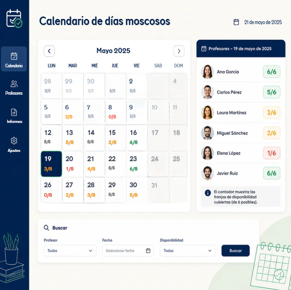
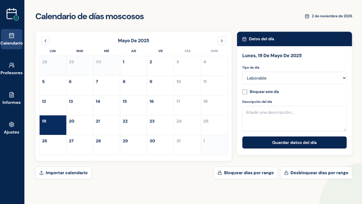
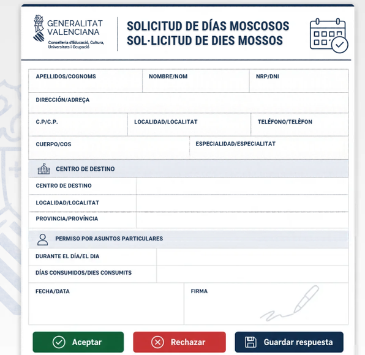
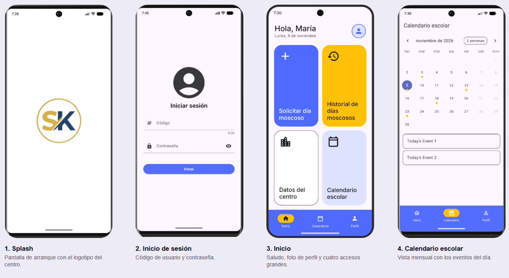
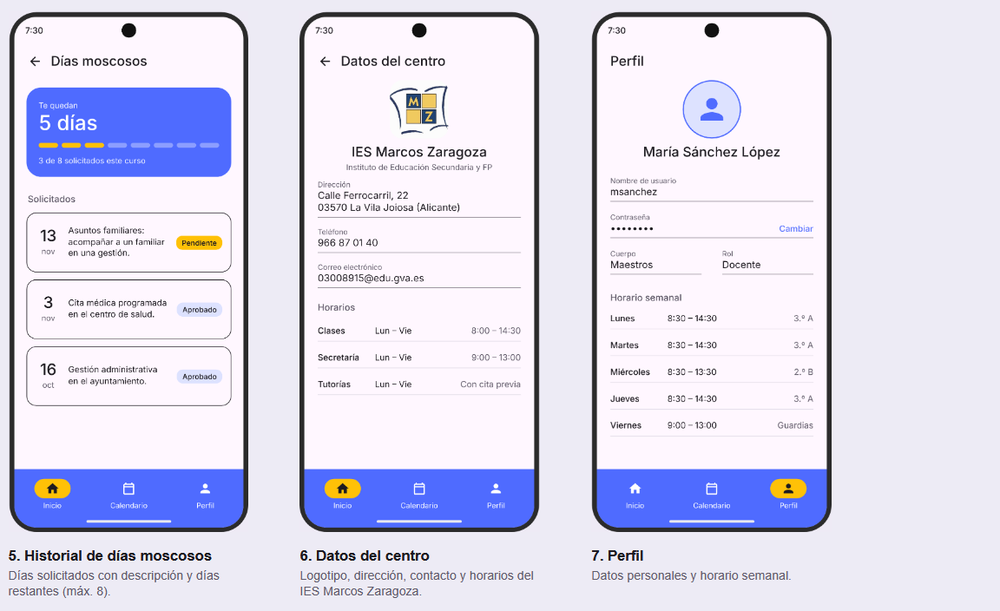

# 4. Diseño de la solución

## 4.1. Diseño general de la aplicación

La solución propuesta estará formada por dos partes principales:

1. **Aplicación web y móvil:** destinada principalmente al profesorado. Permitirá consultar la disponibilidad de los días moscosos, realizar solicitudes y consultar su estado, asimismo también pueden ver el calendario escolar y cambiar la contraseña de usuario.

2. **Programa de escritorio en .NET:** destinado al equipo directivo para revisar, aprobar o rechazar las solicitudes. Además, tanto el equipo directivo como el gestor podrán bloquear rangos e importar calendarios.

## 4.2. Diseño de la interfaz

La interfaz deberá facilitar el uso de las funcionalidades principales según el perfil de cada usuario.  
El diseño de las interfaces puede verse sujeto a cambios y no reflejar el aspecto de las pantallas definitivas.

### Diseño de la interfaz de escritorio:

### Diseño de la interfaz móvil y web:

## 4.3. Diagramas

Se incorporarán los diagramas necesarios para representar el funcionamiento de la aplicación:

- Diagrama de casos de uso.
- Diagramas de actividades o procesos.
- Diagramas de secuencia, si procede.

**Pendiente:** elaborar e incorporar los diagramas.

## 4.4. Flujos de trabajo

Se documentarán los principales procesos de la aplicación:

### Solicitud de un día moscoso

1. El profesor accede a la aplicación.
2. Consulta los días disponibles.
3. Selecciona el día que desea solicitar.
4. Realiza la solicitud.
5. Consulta posteriormente el estado de la solicitud.

### Gestión de solicitudes

1. El equipo directivo accede al programa de gestión.
2. Consulta las solicitudes recibidas.
3. Revisa la información de cada solicitud.
4. Aprueba o rechaza la solicitud.
5. En caso de rechazo, indica el motivo correspondiente.

### Importación de calendarios

1. El gestor o el equipo directivo accede a las funciones de gestión.
2. Selecciona el calendario escolar que desea importar o hace el bloqueo de rangos correspondiente.
3. Realiza la importación o dicho bloqueo.