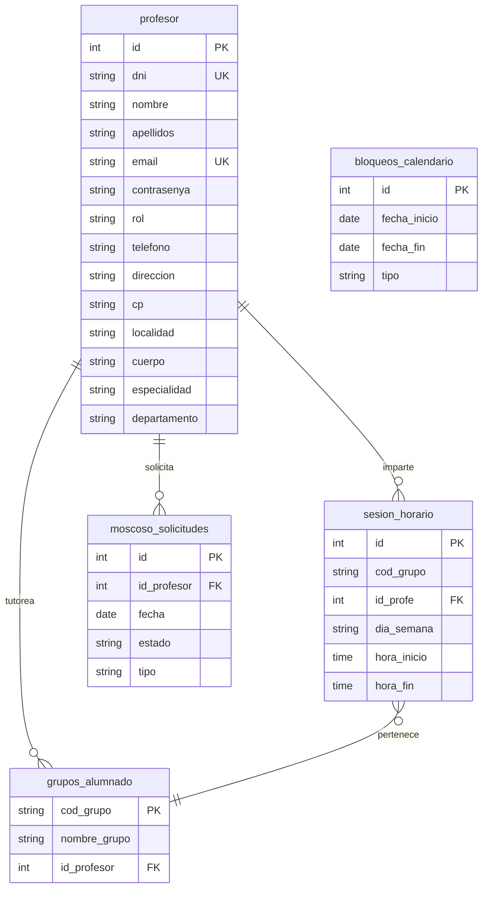
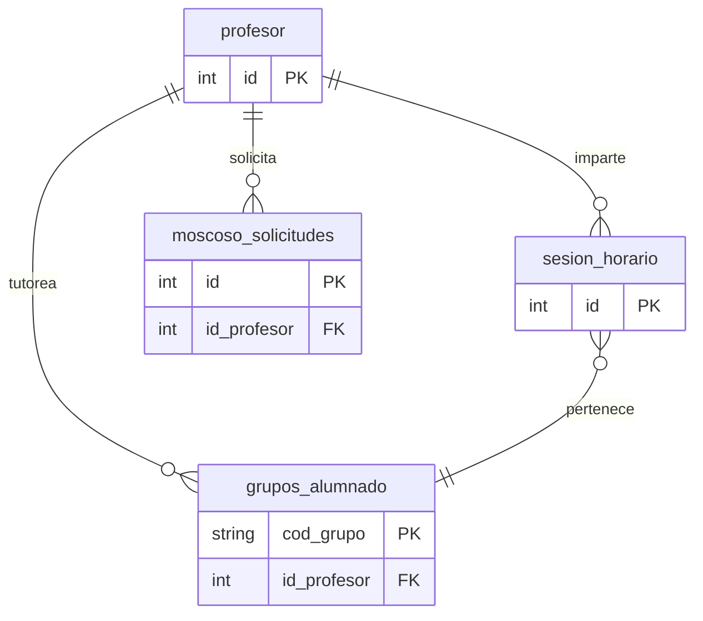

# 6. Modelo de datos

Este apartado describirá cómo se organizará y almacenará la información utilizada por Synkra.

En el análisis inicial se han identificado varios tipos de información necesarios para el funcionamiento de la aplicación:

- Los profesores y sus datos identificativos.
- Los calendarios escolares.
- Las solicitudes de días moscosos.
- Los días moscosos ya disfrutados y los restantes.
- Los turnos de trabajo del profesorado.
- Los grupos de alumnos del profesorado.
- Los roles y permisos de los usuarios.

## 6.1. Diseño de la base de datos

Para almacenar la información de Synkra se utiliza **MySQL** como sistema gestor de bases de datos relacional. Durante el desarrollo se emplea XAMPP para gestionar el servicio de base de datos y phpMyAdmin para facilitar su administración.

La aplicación, desarrollada con Spring Boot, se comunica con MySQL para almacenar, consultar y modificar la información necesaria para su funcionamiento.

La base de datos se organizará mediante tablas relacionadas entre sí. Su estructura se definirá teniendo en cuenta las necesidades de la aplicación y las relaciones entre los distintos tipos de información.

## 6.2. Diagrama entidad-relación

## 6.3. Diccionario de datos

Se documentará la estructura de las tablas de la base de datos, indicando para cada campo:

- Nombre del campo.
- Tipo de dato.
- Clave primaria y claves ajenas, cuando corresponda.
- Restricciones aplicables.

### Tabla `bloqueo_calendario`

| Campo | Tipo | PK/FK | Restricciones | Descripción |
|-------|------|-------|---------------|-------------|
| `id` | `INT` | PK | `NOT NULL`, `AUTO_INCREMENT` | Identificador único de bloqueo |
| `fecha` | `DATE` | - | `UNIQUE`, `NOT NULL` | Día exacto bloqueado en el calendario |
| `comentario` | `VARCHAR(255)` | - | Tamaño máximo de 255 caracteres | Comentario o razón del día bloqueado |
| `tipo` | `ENUM` | - | - | Categoría del bloqueo (festivo, vacaciones, etc.). |

### Tabla `grupo_alumnado`

| Campo | Tipo | PK/FK | Restricciones | Descripción |
|-------|------|-------|---------------|-------------|
| `cod_grupo` | `INT` | PK | `NOT NULL`, `AUTO_INCREMENT` | Identificador único del grupo de alumnado |
| `id_profesor` | `INT` | FK | - | Identificador único del profesor |
| `nombre_grupo` | `VARCHAR(255)` | - | - | Nombre del grupo |

### Tabla `profesores`

| Campo | Tipo | PK/FK | Restricciones | Descripción |
|-------|------|-------|---------------|-------------|
| `id` | `INT(11)` | PK | `NOT NULL`, `AUTO_INCREMENT` | Identificador único del grupo de alumnado |
| `nombre` | `VARCHAR(255)` | - | - | Nombre del profesor |
| `apellidos` | `VARCHAR(255)` | - | - | Apellidos del profesor |
| `dni` | `VARCHAR(255)` | - | `UNIQUE` | Documento que identifica al profesor |
| `email` | `VARCHAR(255)` | - | `UNIQUE` | Correo electrónico del profesor |
| `contrasena` | `VARCHAR(255)` | - | `NOT NULL` | Contraseña cifrada del profesor |
| `cp` | `INT(11)` | - | `NOT NULL` | Código postal de residencia del profesor |
| `localidad` | `VARCHAR(255)` | - | - | Localidad de residencia del profesor |
| `telefono` | `VARCHAR(255)` | - | - | Teléfono de contacto del profesor |
| `direccion` | `VARCHAR(255)` | - | - | Dirección de residencia del profesor |
| `cuerpo` | `VARCHAR(255)` | - | - | Cuerpo docente al que pertenece |
| `rol` | `ENUM` | - | `NOT NULL` | Rol dentro de la aplicación, determina sus permisos |
| `especialidad` | `VARCHAR(255)` | - | - | Especialidad del profesor |
| `departamento` | `VARCHAR(255)` | - | - | Departamento al que pertenece el profesor |
| `grupoAlumnado_cod_grupo` | `INT(11)` | FK | - | Código de grupo referenciando a `grupo_alumnado` |

### Tabla `horarios`

| Campo | Tipo | PK/FK | Restricciones | Descripción |
|-------|------|-------|---------------|-------------|
| `id` | `INT(11)` | PK | `NOT NULL`, `AUTO_INCREMENT` | Identificador único de la sesión del profesor |
| `hora_inicio` | `TIME` | - | - | Hora de inicio de la sesión |
| `hora_fin` | `TIME` | - | - | Hora de fin de la sesión |
| `dia_semana` | `INT(11)` | - | - | Día de la semana de dicha sesión |
| `cod_grupo` | `VARCHAR(255)` | - | - | Código de grupo de la sesión |
| `id_profesor` | `VARCHAR(255)` | - | - | Identificador del profesor de la sesión |
| `grupoAlumnado_cod_grupo` | `INT(11)` | FK | - | Código de grupo referenciando a `grupo_alumnado` |
| `profesor_id` | `INT(11)` | FK | - | Identificador del profesor |

### Tabla `solicitudes`

**Pendiente de completar.**

## 6.4. Relaciones y funcionamiento

Las relaciones y cardinalidades son las siguientes:

- **Tutorea:** un profesor tutorea a un grupo de alumnos (y un grupo tiene asignado un profesor tutor).
- **Pertenece:** un grupo de alumnos cuenta con múltiples sesiones de horario a lo largo de su planificación, mientras que cada sesión de horario pertenece a un único grupo.
- **Imparte:** un profesor imparte varias sesiones de horario.
- **Solicita:** un profesor puede registrar varias solicitudes de días moscosos a lo largo del tiempo.

*Nota: se han incluido en el diagrama las claves primarias y ajenas.*