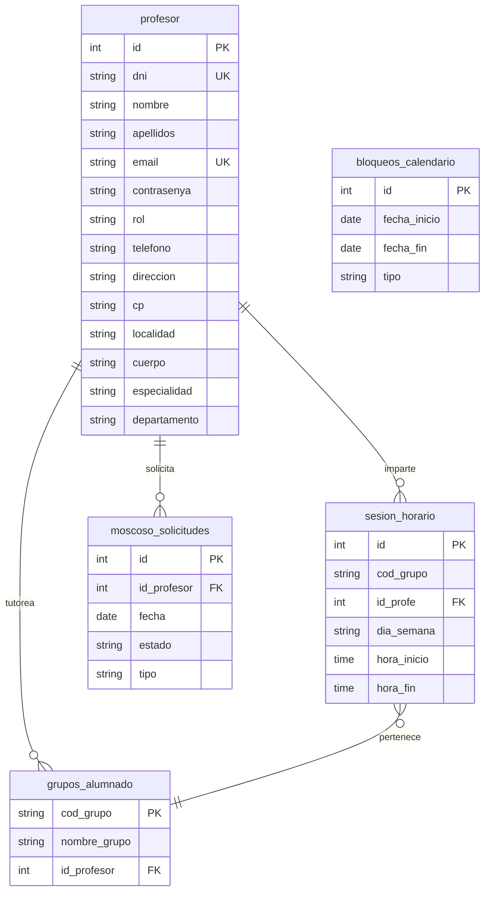

# 6. Modelo de datos

Este apartado describirá cómo se organizará y almacenará la información utilizada por Synkra.

En el análisis inicial se han identificado varios tipos de información necesarios para el funcionamiento de la aplicación:

- Los profesores y sus datos identificativos.
- Los calendarios escolares.
- Las solicitudes de días moscosos.
- Los días moscosos ya disfrutados y los restantes.
- Los turnos de trabajo del profesorado.
- Los grupos de alumnos del profesorado.
- Los roles y permisos de los usuarios.

## 6.1. Diseño de la base de datos

Para almacenar la información de Synkra se utiliza **MySQL** como sistema gestor de bases de datos relacional. Durante el desarrollo se emplea XAMPP para gestionar el servicio de base de datos y phpMyAdmin para facilitar su administración.

La aplicación, desarrollada con Spring Boot, se comunica con MySQL para almacenar, consultar y modificar la información necesaria para su funcionamiento.

La base de datos se organizará mediante tablas relacionadas entre sí. Su estructura se definirá teniendo en cuenta las necesidades de la aplicación y las relaciones entre los distintos tipos de información.

## 6.2. Diagrama entidad-relación

## 6.3. Diccionario de datos

Se documentará la estructura de las tablas de la base de datos, indicando para cada campo:

- Nombre del campo.
- Tipo de dato.
- Clave primaria y claves ajenas, cuando corresponda.
- Restricciones aplicables.

*//TODO aqui es poner lo que tenemos en Spring Boot en los modelos*

## 6.4. Relaciones y funcionamiento

**Pendiente de completar.**