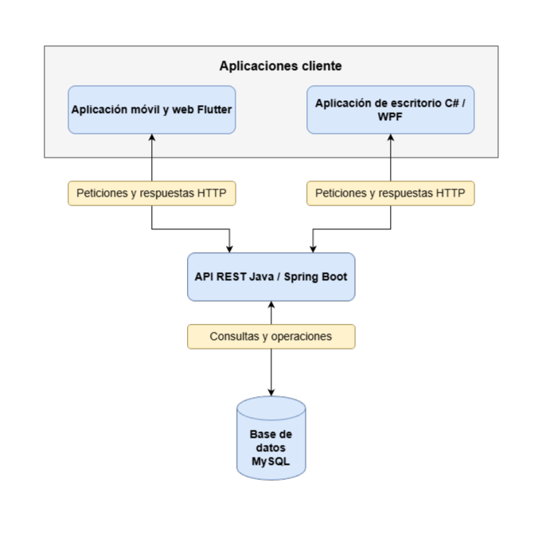

# 7. Arquitectura y tecnologías

## 7.1. Arquitectura de la aplicación

1. **Tipo de arquitectura:** arquitectura cliente-servidor, con una API REST como intermediaria.
2. **Componentes principales:**
    - Aplicación móvil y web (Flutter), utilizada por el profesorado.
    - Aplicación de escritorio (C# y WPF), utilizada por dirección y gestión.
    - API REST (Java y Spring Boot), que procesa las peticiones y centraliza la lógica del servidor.
    - Base de datos (MySQL), donde se almacena la información.
3. **Comunicación:** las aplicaciones cliente envían peticiones HTTP a la API, que consulta o modifica la información de MySQL y devuelve las respuestas correspondientes.
4. **Diagrama:** 

## 7.2. Lenguajes de programación

Para el desarrollo de Synkra se han utilizado diferentes lenguajes y tecnologías, cada uno destinado a una parte específica del sistema:

- **C# con .NET y WPF:** se utiliza para desarrollar la aplicación de escritorio destinada al equipo directivo y gestor. Esta aplicación permite gestionar las solicitudes de días moscosos, administrar los calendarios y configurar los bloqueos de fechas.

- **Dart con Flutter:** se utiliza para desarrollar la aplicación móvil y web destinada principalmente al profesorado. A través de ella, los usuarios pueden consultar su disponibilidad, solicitar días moscosos y realizar el seguimiento de sus solicitudes.

- **Java con Spring Boot:** se utiliza para desarrollar la API que actúa como intermediaria entre las aplicaciones cliente y la base de datos. Esta API centraliza el acceso a la información y permite que tanto la aplicación de escritorio como la aplicación móvil y web puedan consultar y modificar los datos necesarios.

De esta manera, las distintas aplicaciones se comunican con la base de datos a través de una API común, evitando que tengan que acceder directamente a ella.

## 7.3. Frameworks y librerías

En este apartado se describen los principales frameworks y librerías utilizados durante el desarrollo de Synkra, indicando su versión, finalidad y motivo de elección.

### 7.3.1. Programa de escritorio (C# / .NET / WPF)

La configuración principal del proyecto es la siguiente:

- **Lenguaje de programación:** C# 12.
- **Framework:** .NET 8.
- **Tecnología de interfaz gráfica:** Windows Presentation Foundation (WPF).
- Gestor de dependencias: NuGet.
- **Sistema operativo de destino:** Windows.

A continuación, se describen las principales tecnologías utilizadas:

| Framework o tecnología | Versión | Función | Motivo de elección |
|----------------------|---------|---------|--------------------|
| **.NET** | 8 | Plataforma de desarrollo y ejecución del programa de escritorio | Proporciona el entorno y las herramientas necesarias para desarrollar programas para Windows |
| **WPF** | - | Tecnología utilizada para crear la interfaz gráfica de escritorio | Permite diseñar interfaces gráficas fácilmente y personalizadas, y ofrece mayores posibilidades de personalización visual que Windows Forms |

### 7.3.2. Aplicación de escritorio (Dart / Flutter)

La configuración principal del proyecto es la siguiente:

- **Lenguaje de programación:** Dart.
- **Framework:** Flutter.
- **Versión del SDK de Dart:** 3.13.7 o superior.
- **Gestor de dependencias:** Pub.
- **Versión de la aplicación:** 1.0.0.
- **Plataformas de destino:** Android y web, entre otras plataformas compatibles con Flutter.

A continuación, se describen las principales dependencias utilizadas:

| Framework o librería | Versión | Función | Motivo de elección |
|----------------------|---------|---------|--------------------|
| **Flutter** | - | Framework principal utilizado para desarrollar la aplicación móvil y web | Permite desarrollar aplicaciones para distintas plataformas a partir de una misma base de código |
| **Cupertino Icons** | ^2.0.0 | Proporciona un conjunto de iconos con el estilo visual de las interfaces de Apple | Amplía las opciones de iconografía disponibles en la aplicación |
| **Flutter Native Splash** | ^2.4.8 | Permite configurar la pantalla de inicio que aparece mientras se carga la aplicación | Facilita la personalización de la pantalla de carga y la incorporación de la identidad visual de Synkra |
| **Table Calendar** | ^3.3.0 | Proporciona un calendario interactivo para mostrar y seleccionar fechas | Facilita la visualización de los días del calendario y la selección de fechas para las solicitudes |
| **Intl** | ^0.20.2 | Permite trabajar con formatos de fechas, horas y otros datos internacionales | Facilita la adaptación de fechas y formatos a la configuración regional utilizada |
| **HTTP** | ^1.2.2 | Permite realizar peticiones HTTP a la API desarrollada con Spring Boot | Es necesario para la comunicación entre la aplicación y el servidor |
| **Shared Preferences** | ^2.3.2 | Permite almacenar pequeños datos de configuración de forma persistente en el dispositivo | Facilita la conservación de determinadas preferencias y datos locales de la aplicación |

### 7.3.3. API (Java / Spring Boot)

La configuración principal del proyecto es la siguiente:

- **Lenguaje de programación:** Java 21.
- **Framework principal:** Spring Boot 4.1.1.
- **Gestor de dependencias y construcción:** Maven.

A continuación, se detallan las principales dependencias utilizadas en el desarrollo de la API:

| Framework o librería | Versión | Función | Motivo de elección |
|----------------------|---------|---------|--------------------|
| **Spring Boot** | 4.1.1 | Framework principal para desarrollar y ejecutar la API | Facilita la creación de servicios web y la configuración del servidor, es un estándar en Java y hay una amplia documentación disponible |
| **Spring Security** | Gestionada por Spring Boot 4.1.1 | Gestiona la autenticación, la autorización y el control de acceso según los roles | Permite proteger los endpoints de la API y restringir el acceso a determinadas operaciones |
| **JJWT** | 0.12.6 | Permite generar y validar tokens JWT para gestionar la autenticación mediante tokens | Facilita la autenticación de los usuarios y el mantenimiento de sus sesiones mediante tokens |
| **Spring Data JPA** | Gestionada por Spring Boot 4.1.1 | Facilita la comunicación con la base de datos y la gestión de las entidades y consultas | Reduce la necesidad de escribir y consultar SQL manualmente |
| **Hibernate** | Gestionada por Spring Boot 4.1.1 a través de JPA | Implementa el mapeo entre las entidades de Java y las tablas de la base de datos | Permite trabajar con los datos mediante objetos Java |
| **Spring Boot Validation** | Gestionada por Spring Boot 4.1.1 | Permite validar los datos recibidos por la API | Ayuda a evitar que se procesen datos incorrectos o que no cumplan las restricciones establecidas |
| **Spring Web MVC** | Gestionada por Spring Boot 4.1.1 | Permite crear los controladores y endpoints HTTP de la API | Facilita la comunicación entre las aplicaciones clientes y el servidor |
| **Springdoc OpenAPI** | 3.1.0 | Genera documentación de los endpoints de la API y permite consultarla mediante Swagger UI | Facilita la consulta y las pruebas de los servicios disponibles |
| **MySQL Connector/J** | Gestionada por Spring Boot 4.1.1 | Permite establecer la conexión entre la aplicación Java y MySQL | Es el controlador necesario para que Spring Boot pueda comunicarse con la base de datos |
| **Lombok** | Gestionada por Spring Boot 4.1.1 | Reduce código repetitivo (*boilerplate* en inglés) en las clases Java, como *getters*, *setters* y constructores | Facilita el mantenimiento y mejora la legibilidad del código |

## 7.4. Herramientas de desarrollo

Durante el desarrollo de Synkra se han utilizado distintas herramientas para la programación de las aplicaciones, el diseño de la base de datos, el control de versiones, la gestión de la información y la elaboración de la documentación.

### 7.4.1. Entornos de desarrollo y editores

| Herramienta | Uso |
|-------------|-----|
| **IntelliJ IDEA** | Entorno de desarrollo utilizado para programar la API REST desarrollada con Java y Spring Boot |
| **Visual Studio** | Entorno de desarrollo utilizado para implementar la aplicación de escritorio con C# y WPF |
| **Visual Studio Code** | Editor utilizado para desarrollar la aplicación multiplataforma con Flutter y Dart; también se ha empleado para redactar y mantener la documentación del proyecto |
| **Android Studio** | Herramienta utilizada para configurar y gestionar emuladores de dispositivos Android; aunque la aplicación Flutter se ejecutaba desde Visual Studio Code |

### 7.4.2. Control de versiones

| Herramienta | Uso |
|-------------|-----|
| **GitHub** | Plataforma utilizada para alojar el repositorio del proyecto y gestionar el control de versiones del código fuente y documentación; también se utiliza GitHub Projects para organizar y realizar el seguimiento de las tareas mediante un tablero Kanban |

### 7.4.3. Herramientas de diseño

| Herramienta | Uso |
|-------------|-----|
| **DrawSQL** | Herramienta utilizada para diseñar y representar el diagrama entidad-relación de la base de datos |
| **Herramienta de diseño de mockups** | - |
| Drawio | Para la creación de algunos diagramas de esta documentación |

### 7.4.4. Bases de datos

| Herramienta | Uso |
|-------------|-----|
| **MySQL** | Sistema gestor de bases de datos relacional utilizado para almacenar y gestionar la información de Synkra |
| **XAMPP** | Entorno utilizado para proporcionar y gestionar el servicio local de MySQL durante el desarrollo |
| **phpMyAdmin** | Herramienta utilizada para administrar la base de datos MySQL mediante una interfaz web |

### 7.4.5. Documentación

| Herramienta | Uso |
|-------------|-----|
| **Visual Studio Code** | Editor utilizado para redactar y modificar los archivos de documentación en formato Markdown |
| **MkDocs** | Herramienta utilizada para generar el sitio web de la documentación del proyecto a partir de archivos Markdown |

## 7.5. Justificación tecnológica

La elección de las tecnologías utilizadas en Synkra se ha basado principalmente en los conocimientos previos del equipo, la disponibilidad de documentación y las necesidades del proyecto.

- **Java y Spring Boot:** se han elegido por ser tecnologías consolidadas, contar con abundante documentación y porque el equipo ya tenía conocimientos previos de Java.
- **C# y .NET con WPF:** se han seleccionado por su adecuación al desarrollo de aplicaciones de escritorio para Windows, su amplia documentación y las similitudes de C# con Java.
- **Dart y Flutter:** se han elegido porque permiten desarrollar aplicaciones móviles y web a partir de una misma base de código, reduciendo la duplicación de trabajo.
- **MySQL:** se ha seleccionado por ser un sistema relacional adecuado para organizar la información y las relaciones entre los distintos datos del proyecto.
- **GitHub:** se utiliza para facilitar el trabajo colaborativo, mantener un historial de cambios y organizar el desarrollo del proyecto.
